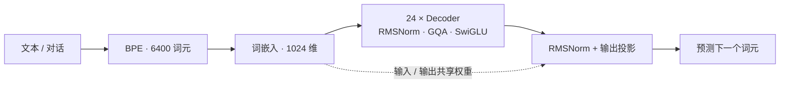

<p align="center">
  
</p>

<h2 align="center"><em>A journey of a thousand miles begins with a single step.</em></h2>
<p align="center">
  <sub>— Laozi, <a href="https://ctext.org/dao-de-jing/zh"><em>Tao Te Ching</em>, Chapter 64</a> · English rendering</sub>
</p>

<p align="center"><strong>小参数，大能力。持续增强，走向端侧。</strong></p>
<p align="center">
  <a href="#当前进度">当前进度</a> ·
  <a href="#架构设计">架构设计</a> ·
  <a href="#版本路线">版本路线</a> ·
  <a href="#运行入口">运行入口</a> ·
  <a href="#借鉴与来源">借鉴与来源</a>
</p>

EdgeMind 以「小参数，大能力」为目标，是一个从零训练、持续研究小模型能力增强、面向端侧部署的语言模型项目。它关注三个可以验证的问题：有限参数能学会什么，哪些训练与结构改动确实有效，以及这些收益在压缩和真机运行后能保留多少。

工程坚持极简主义、第一性原理和小步迭代。模型核心组件采用手写 PyTorch 实现；配置与分词复用成熟库，每次增加一个当前需要的功能，并解释设计原因。

> [!NOTE]
> **致谢、来源与后续方向**
>
> 感谢 [MiniMind](https://github.com/jingyaogong/minimind) 作者 [Jingyao Gong](https://github.com/jingyaogong) 及社区贡献者，开放小模型训练代码、分词器、对话模板、语料与实践经验。EdgeMind 首版参考其模型组件、数据组织和分阶段训练思路，并复用分词器、对话模板与阶段语料，以尽快获得可见成品、积累完整流程的经验。
>
> 同时感谢 [PyTorch](https://github.com/pytorch/pytorch)、Hugging Face 的 [Transformers](https://github.com/huggingface/transformers) 与 [Tokenizers](https://github.com/huggingface/tokenizers)、[Jinja](https://github.com/pallets/jinja)、[Python](https://www.python.org/) 及其上游依赖、公开数据贡献者和开源社区，为本项目提供计算、配置、分词、对话排版与基础工具。
>
> **v1.0 的后续重点是端侧验证**：在预训练与 SFT 基础上，补充基本对话和简单前端，尝试模型转换、量化与一台已有设备上的离线推理，并记录能力变化、内存占用与生成速度。
>
> **v2.0 及以后重点开展自己的能力实验**：逐项尝试数据质量改进、强模型的教学示范、可验证任务反馈、持续学习、模型结构调整与端侧压缩，用一致的评测比较收益和成本。这些是后续研究方向，结果将以实际实验为准。
>
> MiniMind 复用内容保留 [Apache-2.0 许可全文](LICENSES/Apache-2.0.txt)及上游来源说明；其他依赖和数据遵循各自的许可条件。具体来源、复用与改写范围见 [THIRD_PARTY_NOTICES.md](THIRD_PARTY_NOTICES.md)，项目许可范围见文末的[借鉴与来源](#借鉴与来源)。

## 当前进度

**当前版本：v0.2 · 首轮 mini SFT 已完成。正在准备从已有 Base 开始完整数据的持续预训练。**

| 阶段 | 状态 | 已有证据或下一目标 |
| --- | --- | --- |
| v0.1 Base | ✅ 首轮完成 | 权重保存、重新加载与文本续写已跑通；已有温度与 `top_p` 采样入口 |
| v0.2 Instruct | ✅ 首轮 mini SFT 完成 | 已在 AutoDL 完成一轮示范微调；回答质量与工具调用准确率仍需系统评测 |
| 全量 Base 续训 | 🛠️ 准备启动 | 加载已有 Base、预热与余弦衰减、定期保存及中断恢复已实现；正式全量训练尚未开始 |
| v1.0 Edge | 📍 计划交付 | 基本对话、简单前端、一台已有设备上的本地推理，以及能力和性能记录 |
| v2.0 与后续版本 | 🔬 能力实验 | 通过数据、教学信号、学习方法与结构对照，研究小模型能力和端侧成本 |

初次 Base 续写能生成主题相关的中文，但存在重复、常识错误和内容连贯性不足。首轮 mini SFT 已完成，接下来回到原来的 Base 权重，使用更完整的正文数据补充基础能力，再以新的 Base 做 SFT 并比较前后表现。完成训练不等于能力已经达标，当前不以单段示例或训练误差宣称通用能力、稳定对话或工具执行已得到验证。

## 架构设计

### 在约 0.3B 预算内，采用更宽、更深的 Dense 结构

EdgeMind 当前采用 **24 层 × 1024 隐藏宽度**，实际总参数为 **277,136,384**。宽度表示每个文字位置在模型内部使用多少个数表达信息；深度表示这些信息经过多少层转换。这里的“深”指层数，上下文上限另行定义。

设计重点是把容量分配给 Decoder 主体，并通过共享输入与输出权重控制词表开销。它提供了一个自主配置的宽深基线，后续可以在相近参数、数据和训练预算下比较不同深宽分配。当前没有宣称这组配置已经优于其他结构，收益需要实验验证。



| 配置 | 当前值 | 设计含义 |
| --- | --- | --- |
| 模型类型 | Dense、Decoder-only | 每个输入使用完整 Decoder 主体，保持首版训练与部署路径清晰 |
| 深度 / 隐藏宽度 | 24 / 1024 | 研究约 0.3B 容量下的表达与多层信息转换 |
| 前馈层宽度 | 2816 | 配合 SwiGLU 分配每层容量 |
| 查询头 / 键值头 | 16 / 4 | GQA 让多组查询共享键值表示 |
| 注意力计算 | PyTorch SDPA | Q/K/V 投影与掩码手写，注意力运算复用 PyTorch；实际 GPU 实现由输入条件决定 |
| 词表 / 权重共享 | 6400 / 输入与输出共享 | 使用现成 BPE 词表，词嵌入仍随模型从随机权重训练 |
| 位置编码 | RoPE，`theta=1e6` | 为不同文字位置提供相对位置信息 |
| 上下文位置上限 | 2048 | 当前是配置上限，不等于已验证的长文本能力 |
| 默认训练长度 | 预训练 512 / SFT 1024 | 按当前阶段控制样本长度；实际值由训练参数指定 |

核心实现见 [模型配置](model/configuration_edgemind.py) 与 [模型计算](model/modeling_edgemind.py)。

## v0.2：从续写走向对话

SFT，也就是示范微调：给模型问题与目标回答，让它学习怎样按要求回应。这个阶段从 v0.1 的 Base 权重开始，保持原模型结构。

已实现：

- **对话排版**：独立的 `chat_template.jinja`，统一训练时的角色、回答和工具片段。
- **数据读取**：`SFTDataset` 按需读取 JSONL，对 `tools`、`tool_calls` 的字符串字段进行解析。
- **助手标签**：用户提问与工具返回作为上下文，只在助手输出及其结束位置计算预测误差，填充位置忽略。
- **训练入口**：加载 Base 的配置和权重，使用单卡 CUDA / BF16，每个有有效助手目标的批次更新一次，并在整轮结束保存。
- **空目标处理**：截断后整批没有助手回答时提示并跳过；整轮没有更新时拒绝保存未经微调的“成果”。

首轮已使用 [`sft_t2t_mini.jsonl`](https://huggingface.co/datasets/jingyaogong/minimind_dataset/blob/main/sft_t2t_mini.jsonl)，约 1.74 GB，包含普通对话与部分工具调用示范。支持读取工具样本不等于已经接入工具服务；工具执行属于后续独立功能。

普通对话的简化格式如下，内容为本项目示例：

```json
{"conversations":[{"role":"user","content":"你好"},{"role":"assistant","content":"你好！我是 EdgeMind。"}]}
```

**首轮 GPU SFT 已完成，回答质量与独立评测继续完善。**SFT 脚本仍采用固定学习率，整轮结束保存权重和配置；本次增加的定期保存与中断恢复用于预训练脚本。

### 回到 Base，扩大预训练数据

下一轮使用 [`pretrain_t2t.jsonl`](https://huggingface.co/datasets/jingyaogong/minimind_dataset/blob/main/pretrain_t2t.jsonl)，当前约 8.28 GB，每条记录仍包含 `text` 字段。加载首轮 Base 已学到的权重，开始一个新的预训练阶段；本轮使用原 Base 作为起点，而不是 SFT 权重。整份文件都会读取，每条正文仍按指定长度截断。

- `--init_from`：加载旧 Base 的配置与权重，为新阶段创建新的参数更新历史和学习率安排。
- `--resume`：恢复同一次预训练的模型、更新历史、学习率位置、已完成批次和随机状态。
- 每轮按固定种子打乱数据，恢复时直接读取剩余样本；数据文件、轮数、批大小、长度和峰值学习率必须保持一致。
- 每隔 `save_interval` 次更新及每轮结束保存完整的 `pretrain_resume.pth`，只保留最新一份；整轮另存 `pretrain_epoch_N.pth`，供续写测试和 SFT 使用。
- 保存时先完成临时文件，再替换正式文件；新阶段默认使用独立的 `pretrain_full` 目录，保留旧 Base 和首轮 SFT 作为对照。

本轮先使用较小的峰值学习率 `1e-4`，前 1% 的更新逐渐增大学习率，之后平滑降到峰值的 10%。学习率日志显示本批实际使用的值，首批即会更新权重。本地已用两层小模型验证轮内、轮末中断恢复后的权重与参数更新历史和连续训练完全一致；这是 CPU 功能验证，正式 GPU 全量训练的速度、显存与能力收益，以后续实测为准。

## 版本路线

### v1.0：先交付一个可见、可运行的成品

首版沿成熟的预训练 → SFT 路线推进，尽快形成可展示的模型，并积累数据处理、训练、推理和部署经验。完成标准是：

- [x] 从随机权重开始完成首轮 Base 预训练。
- [x] 完成 SFT 数据与训练入口。
- [x] 在 AutoDL 完成一轮 mini SFT，保留阶段权重。
- [ ] 得到能进行基本短对话的权重，并保留训练前后对照。
- [ ] 补充简单聊天前端。
- [ ] 完成模型转换与量化，在一台已有设备上离线运行。
- [ ] 记录量化前后效果，以及真机内存、首次响应时间、生成速度。

端侧验收要求模型在设备本地推理。具体设备与推理框架待适配验证，前端连接远端 GPU 服务不计作端侧部署完成。

### v2.0：让自己的方法产生可验证的收益

v1.0 为后续研究保留基础模型、对话模型、部署版本和评测记录。v2.0 不限于复现既有教程，也可以回到预训练或重新设计模型结构。

| 候选路线 | 要回答的问题 |
| --- | --- |
| 更有效的数据与持续预训练 | 相同训练预算下，清洗、配比与教材式内容是否提高能力？ |
| 教师示范与简短推理蒸馏 | 小模型是否能从经过验证的简短步骤中学到更可迁移的规则？ |
| 任务反馈与强化学习 | 用真正的任务成功来指导训练，是否优于普通示范微调？ |
| 持续学习与离线巩固 | 接收新经验后，怎样学会新任务并减少旧能力退步？ |
| 深宽分配、共享层与混合结构 | 同样参数、训练量和推理成本下，结构改动是否值得？ |
| 回答时的计算与端侧压缩 | 有限重试、工具或量化适配的收益，是否抵得上增加的设备成本？ |

这些是候选方向。每次只选择一个主要变化，使用独立测试集，并记录能力、数据量、计算与设备成本。完整调研见 [小模型能力增强笔记](docs/small_model_enhancement.md)。

## 运行入口

下面是当前入口的复现示例。正式数据和权重放在 AutoDL 数据盘，代码仓库只包含少量格式检查样本。

<details>
<summary><strong>展开 AutoDL 环境、数据与训练命令</strong></summary>

### 1. 环境与代码

已使用的 AutoDL 镜像组合为 PyTorch 2.8 / Python 3.12 / CUDA 12.8。保留镜像中的 GPU PyTorch；配置与分词器使用 Transformers 5.17.0。

```bash
cd /root/autodl-tmp
git clone https://github.com/johnnyjjj0402-png/EdgeMind.git
cd EdgeMind
python -m pip install "transformers==5.17.0"
nvidia-smi
python -c "import torch; print('GPU:', torch.cuda.is_available(), 'BF16:', torch.cuda.is_bf16_supported())"
```

### 2. 下载首轮阶段数据

```bash
mkdir -p /root/autodl-tmp/datasets

curl -fL --retry 3 --connect-timeout 20 -C - \
  https://huggingface.co/datasets/jingyaogong/minimind_dataset/resolve/main/pretrain_t2t_mini.jsonl \
  -o /root/autodl-tmp/datasets/pretrain_t2t_mini.jsonl

curl -fL --retry 3 --connect-timeout 20 -C - \
  https://huggingface.co/datasets/jingyaogong/minimind_dataset/resolve/main/sft_t2t_mini.jsonl \
  -o /root/autodl-tmp/datasets/sft_t2t_mini.jsonl
```

### 3. 从零预训练与续写测试

预训练数据每行包含一个非空 `text` 字段。示例每批 8 条、长度 512；具体批大小需要结合 GPU 显存实测。

```bash
python -u -m trainer.train_pretrain \
  --data_path /root/autodl-tmp/datasets/pretrain_t2t_mini.jsonl \
  --save_dir /root/autodl-tmp/edgemind/checkpoints \
  --epochs 1 --batch_size 8 --max_length 512

python eval_pretrain.py \
  --weights /root/autodl-tmp/edgemind/checkpoints/pretrain_epoch_1.pth \
  --prompt "人工智能是一种" \
  --max_new_tokens 100 --temperature 0.85 --top_p 0.95
```

`--temperature 0` 可对照每次选择最高分的生成方式。随机采样应固定参数、使用多个文本开头并重复观察；续写展示不能替代独立评测。

### 4. 检查 SFT 数据，再启动微调

两份检查脚本只做文本渲染、分词和样本检查，可以在本地 CPU 上运行。正式 SFT 需要前一步保存的 Base 权重。

```bash
python check_chat_template.py
python check_sft_dataset.py
python -m trainer.train_sft --help

python -u -m trainer.train_sft \
  --data_path /root/autodl-tmp/datasets/sft_t2t_mini.jsonl \
  --init_from /root/autodl-tmp/edgemind/checkpoints/pretrain_epoch_1.pth \
  --save_dir /root/autodl-tmp/edgemind/checkpoints \
  --epochs 1 --batch_size 2 --max_length 1024 --learning_rate 1e-4
```

上面的 SFT 示例训练一轮；首轮 mini SFT 已在 AutoDL 完成，训练脚本默认轮数仍为 2。SFT 长度比预训练大，批大小需结合 GPU 实测。每轮输出 `sft_epoch_N.pth`，不会覆盖 `pretrain_epoch_N.pth`；对话能力仍需独立评测。

### 5. 使用完整语料，从已有 Base 继续预训练

已有仓库直接拉取更新。以下命令保留原 Base 和 SFT 文件，把新结果存入独立目录。

```bash
cd /root/autodl-tmp/EdgeMind
source /etc/network_turbo
git -c http.version=HTTP/1.1 pull --ff-only origin main
mkdir -p /root/autodl-tmp/datasets

curl -fL --retry 3 --connect-timeout 20 -C - \
  https://huggingface.co/datasets/jingyaogong/minimind_dataset/resolve/main/pretrain_t2t.jsonl \
  -o /root/autodl-tmp/datasets/pretrain_t2t.jsonl
```

确认代码拉取和下载命令都成功结束后，再启动训练：

```bash
python -u -m trainer.train_pretrain \
  --data_path /root/autodl-tmp/datasets/pretrain_t2t.jsonl \
  --init_from /root/autodl-tmp/edgemind/checkpoints/pretrain_epoch_1.pth \
  --save_dir /root/autodl-tmp/edgemind/checkpoints/pretrain_full \
  --epochs 1 --batch_size 8 --max_length 512 \
  --learning_rate 1e-4 --save_interval 1000 \
  2>&1 | tee /root/autodl-tmp/edgemind/pretrain_full.log
```

先确认下载完整、日志显示加载旧 Base，并且训练开始正常更新。batch 8 是起点，不能仅凭模型能加载就判断整批训练显存够用；开始新阶段时可按实测调整。

### 6. 中断后，恢复同一次全量训练

使用 `--resume` 替代 `--init_from`，其他影响训练进度的参数保持与原命令相同。恢复到最近成功保存的位置；其后尚未保存的批次需要重新训练。没有恢复文件时，应使用上一节的 Base 起点命令。

```bash
python -u -m trainer.train_pretrain \
  --data_path /root/autodl-tmp/datasets/pretrain_t2t.jsonl \
  --resume /root/autodl-tmp/edgemind/checkpoints/pretrain_full/pretrain_resume.pth \
  --save_dir /root/autodl-tmp/edgemind/checkpoints/pretrain_full \
  --epochs 1 --batch_size 8 --max_length 512 \
  --learning_rate 1e-4 --save_interval 1000 \
  2>&1 | tee -a /root/autodl-tmp/edgemind/pretrain_full.log
```

完整恢复文件还保存参数更新历史，体积会大于只保存模型权重的文件。整轮完成后的新 Base 位于 `pretrain_full/pretrain_epoch_1.pth`，可先用 `eval_pretrain.py` 测试续写，再加载它进行新一轮 SFT。

</details>

## 文件导航

```text
model/configuration_edgemind.py   模型结构与约束
model/modeling_edgemind.py        手写 Decoder 与预测误差
model/tokenization_edgemind.py    本地分词器加载
model/chat_template.jinja         训练与推理的对话排版
dataset/lm_dataset.py             预训练 / SFT 样本构造
dataset/*_smoke.jsonl             少量格式检查样本
trainer/train_pretrain.py         从零 / 加载 Base / 恢复预训练
trainer/train_sft.py              加载 Base 的 SFT 入口
eval_pretrain.py                  文本续写与采样测试
check_chat_template.py            对话模板检查
check_sft_dataset.py              助手标签检查
```

## 更新日志

### v0.2 · 首轮 SFT 完成与全量续训准备（2026-10-13）

- 已在 AutoDL 完成一轮 `sft_t2t_mini.jsonl` 的 SFT；对话和工具调用能力继续评测。
- 注意力已接入 SDPA，保留因果、填充与历史缓存规则，位置编码后恢复原精度。
- 预训练新增加载已有 Base、定期保存完整状态与中断恢复；新阶段结果使用独立目录。
- 修正首批零学习率和日志显示下一批学习率的问题，补充全量数据下载、启动与恢复命令。
- 完整语料的 GPU 持续预训练尚未开始，不预先宣称能力提升或端侧部署完成。

### v0.2 · SFT 准备（2026-10-09）

- 接入独立聊天模板，支持普通对话、思考字段与工具调用片段。
- 新增 SFT 数据读取、助手标签和加载 Base 权重的 GPU 训练入口。
- 新增模板与样本检查，补充截断后空目标批次的处理。
- 更新项目视觉、宽深配置说明，以及 v1.0 / v2.0 路线。正式 SFT 尚未完成。

### v0.1 · Base 首轮完成（2026-10-07—08）

- 完成约 0.277B Dense 模型与预训练样本构造。
- 在 AutoDL 完成首轮预训练，保存并重新加载权重，跑通文本续写。
- 增加温度与 `top_p` 采样，对照原有最高分选择；初次续写的重复问题继续评估。

## 借鉴与来源

v1.0 的模型组件、数据组织与训练流程参考 [MiniMind](https://github.com/jingyaogong/minimind)，并复用其分词器、对话模板与第一阶段语料。这样选择是为了尽快获得可见成品、积累完整流程的实践经验，再以 EdgeMind 的配置、评测和端侧结果开展后续能力研究。

来源说明集中在 [THIRD_PARTY_NOTICES.md](THIRD_PARTY_NOTICES.md)，上游文件中的出处也予以保留。复用内容的 Apache-2.0 许可全文见 [LICENSES/Apache-2.0.txt](LICENSES/Apache-2.0.txt)；本仓库尚未为所有原创新增内容统一声明整体许可证。

训练数据有独立的来源条件，上游数据卡同时列出 Apache-2.0 与 CC-BY-NC-2.0，不能用代码许可覆盖全部数据或未来权重。正式语料与训练权重不随本代码仓库分发。首页 SVG 标识为 EdgeMind 原创。
